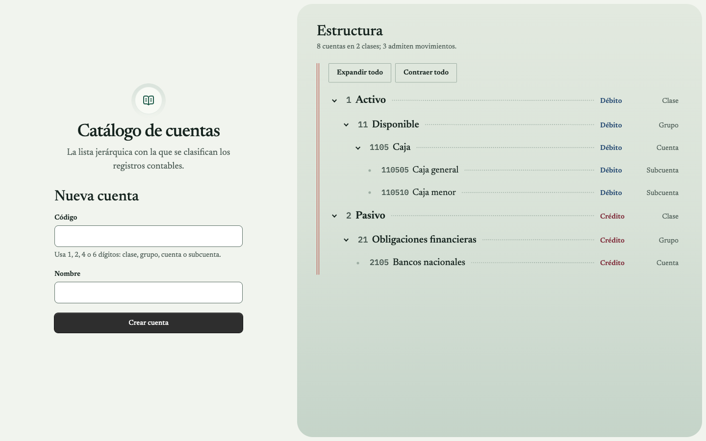

# Catálogo de cuentas

Módulo de Aravia que administra el catálogo de cuentas contables: la lista jerárquica de clases, grupos, cuentas y subcuentas con la que una empresa clasifica sus registros. API en NestJS con Clean Architecture y pantalla en React.



## Cómo correrlo

Requisitos: **Node 22 o superior** y **npm 10 o superior**.

```bash
npm install     # instala la raíz, api/ y web/
npm run dev     # levanta los dos a la vez
```

Abre http://localhost:5173. La API queda en http://localhost:3000 y arranca con el catálogo de ejemplo del enunciado.

| Script | Qué hace |
|--------|----------|
| `npm run dev` | API y front juntos, en modo watch |
| `npm test` | Pruebas unitarias del API y del front |
| `npm run test:e2e` | Pruebas e2e del API (supertest) |
| `npm run lint` | `oxlint` en los dos |
| `npm run build` | Compila los dos |

Configuración, por variables de entorno (todas opcionales):

| Variable | Dónde | Por defecto |
|----------|-------|-------------|
| `PORT` | API | `3000` |
| `WEB_ORIGIN` | API (único origen permitido por CORS) | `http://localhost:5173` |
| `VITE_API_URL` | front (ver `web/.env.example`) | `http://localhost:3000` |

## Qué resuelve del enunciado

**Núcleo del backend**
- Crear cuenta: valida que el código sea numérico, de longitud válida (1, 2, 4 o 6 dígitos), que no exista y que su padre exista.
- Consultar el catálogo como árbol anidado.
- Eliminar una cuenta, rechazando la operación si tiene hijas.

**Núcleo del frontend**
- Árbol con expandir y colapsar.
- Formulario con validación antes de enviar y con los errores de la API junto al campo que corresponde.
- Eliminar desde el árbol con confirmación, mostrando el error cuando la cuenta tiene hijas.
- Estados de carga y de error en las dos operaciones (con "Reintentar"), y un estado vacío. Ninguna pantalla en blanco ni errores solo en consola.

**Reglas del dominio y dónde vive cada una**

| Regla | Dónde se garantiza |
|-------|--------------------|
| Código numérico, y la longitud define el nivel | `AccountCode` (dominio) |
| El padre es el prefijo del nivel anterior; las clases no tienen padre | `AccountCode.parent()` |
| Una clase define su naturaleza y los descendientes la heredan | `Account.createClass` y `Account.createChild` (dominio) |
| El código es único | `CreateAccount` (caso de uso) |
| No se crea una cuenta si su padre no existe | `CreateAccount` |
| No se elimina una cuenta con hijas | `DeleteAccount` |
| Solo las cuentas sin hijas admiten movimientos | `GetCatalogTree` (`acceptsMovements`) |

## Backend: Clean Architecture

Lo que entiendo de ella, con mis palabras: el código se organiza en capas concéntricas y **las dependencias solo apuntan hacia adentro**. Lo más estable (las reglas del negocio) no sabe nada de lo más cambiante (el framework, la base de datos, el formato HTTP). Así, cambiar de Nest a otra cosa o de memoria a Postgres no obliga a tocar las reglas.

```
api/src/accounts/
  domain/          Reglas del negocio. No importa nada de Nest ni de la base de datos.
                   AccountCode, Account, Nature, errores de dominio y la interfaz
                   AccountRepository (la define el dominio, no la infraestructura).
  application/     Casos de uso: CreateAccount, GetCatalogTree, DeleteAccount.
                   Dependen de la interfaz del repositorio, nunca de una implementación.
  infrastructure/  InMemoryAccountRepository: implementa la interfaz del dominio.
  presentation/    Controlador, DTO con validación, filtro de excepciones. Traduce HTTP.
  accounts.module.ts   El único lugar que conoce Nest y une todo con factories.
```

Decisiones que sostienen esa idea:
- **Inversión de dependencias:** el repositorio es una interfaz del dominio. Los casos de uso la reciben por constructor, así que se prueban sin Nest y sin base de datos.
- **Sin decoradores de Nest en `application/`.** El módulo registra los casos de uso con factories. Si el framework cambia, esa capa no se entera.
- **Entidades y value objects inmutables.** Las operaciones devuelven instancias nuevas.
- **Los casos de uso devuelven datos planos** (`AccountView`, `AccountNode`), nunca entidades.
- **Validación en el borde y en el dominio.** El DTO rechaza formas inválidas, pero el dominio vuelve a proteger sus invariantes, así que ninguna regla depende solo del DTO.

### API

| Método | Ruta | Respuesta |
|--------|------|-----------|
| `POST` | `/accounts` | `201` con la cuenta creada |
| `GET` | `/accounts/tree` | `200` con el árbol anidado |
| `DELETE` | `/accounts/:code` | `204` sin cuerpo |

Todos los errores tienen la misma forma, pensada para pintar cada mensaje junto a su campo:

```json
{ "code": "ACCOUNT_CODE_ALREADY_EXISTS", "message": "Ya existe una cuenta con el código 1105.",
  "errors": [{ "field": "code", "message": "Ya existe una cuenta con el código 1105." }] }
```

`400` entrada inválida · `404` la cuenta no existe · `409` código duplicado o cuenta con hijas · `422` el padre no existe · `413` cuerpo demasiado grande · `429` demasiadas solicitudes · `500` genérico, sin detalles internos.

## Persistencia: en memoria

Elegí guardar en memoria (un `Map`, precargado con el catálogo de ejemplo) por una razón de alcance: el enunciado prioriza un módulo que funcione de punta a punta y dos horas no alcanzan para sumar una base de datos sin sacrificar la pantalla. El costo es real: **los datos se pierden al reiniciar la API**.

Pasar a una base de datos es agregar **una** clase que implemente `AccountRepository` y cambiar **una** línea en `accounts.module.ts`. Los casos de uso, el controlador y las pruebas no cambian.

## Frontend

Lo organicé **por feature, no por tipo de archivo**: todo lo del catálogo vive junto, y lo que podría reutilizarse está aparte. Así, quien abre `features/accounts/` entiende el módulo completo sin saltar entre carpetas globales de `components/`, `hooks/` y `utils/`. En el front no exigían Clean Architecture; apliqué solo la idea que más rinde: **los componentes no conocen `fetch`**.

```
web/src/
  features/accounts/
    api/           Cliente HTTP tipado y ApiError (mensajes por campo). Único lugar con fetch.
    hooks/         TanStack Query: cargar el árbol, crear y eliminar (con invalidación).
    validation/    Reglas del formulario, espejo de las del dominio.
    components/    AccountTree, AccountForm, ConfirmDeleteDialog.
    AccountsPage.tsx
  components/ui/   Primitivas compartidas (estilo shadcn): FancyButton, Field, Input.
  lib/  styles/  app/  test/
```

**Librerías y qué resuelve cada una**

| Librería | Qué resuelve |
|----------|--------------|
| `@tanstack/react-query` | Caché del servidor, estados de carga y error, e invalidación tras crear o eliminar, en vez de recargar a mano. |
| `tailwindcss` (v4) | Utilidades y tokens de diseño. La paleta se define una vez y los componentes la heredan. |
| `@base-ui/react` | Primitiva de botón accesible, sobre la que está el `FancyButton` de la plantilla de formulario. |
| `class-variance-authority`, `clsx`, `tailwind-merge` | Variantes de componentes y composición de clases sin conflictos (`cn`). |
| `lucide-react` | Íconos. |
| `vitest`, Testing Library, `jsdom`, `axe-core` | Pruebas de componentes y comprobación automática de accesibilidad. |

No usé una librería de componentes completa. El árbol, que es la pieza difícil, necesita un patrón de accesibilidad exacto (WAI-ARIA *tree*) y prefiero controlarlo yo. `tw-animate-css` quedó instalado porque lo pide la plantilla, pero hoy no se usa ninguna animación suya.

## Opcionales que tomé, y por qué

- **Nivel y naturaleza visibles en el árbol.** Es barato y hace visibles en pantalla las reglas del dominio. Se dicen con palabras, no solo con color.
- **Crear hija desde el nodo padre, con el código prellenado.** Evita el error más común: escribir un código sin padre.
- **Estado del servidor con caché e invalidación.** Viene incluido al usar TanStack Query.

**Los que dejé fuera:** *buscar por código o nombre* y *renombrar*. Con el tiempo disponible prefería terminar bien las reglas, los errores por campo y la accesibilidad antes que sumar funciones a medias.

## Seguridad

- **Validación doble:** DTO en el borde (`whitelist` y `forbidNonWhitelisted`, así un campo extra como `isAdmin` se rechaza) y de nuevo en el dominio. El front también valida, pero solo como ayuda: el servidor no confía en él.
- **Errores sin fugas:** un filtro único convierte los errores de negocio en 4xx; cualquier otro devuelve un `500` genérico y el detalle queda solo en el log del servidor.
- `helmet`, CORS limitado a un único origen, cuerpo máximo de 10 kb y límite de 100 solicitudes por minuto por IP.
- El front nunca usa `dangerouslySetInnerHTML` y codifica el código con `encodeURIComponent` al armar la URL.
- Hay pruebas de un fragmento SQL en el código, de campos no permitidos, de un cuerpo grande y de que un error interno no filtre su mensaje.

## Accesibilidad (WCAG 2.2 AA)

- **Árbol** con `role="tree"` y `treeitem`, `aria-level` y `aria-expanded`. Un solo elemento en el orden de tabulación; flechas, `Home`, `End`, `Enter` y `Supr` para moverse y actuar.
- **Nada se selecciona ni se abre solo:** recibir foco no selecciona; solo el clic o las teclas.
- **Formulario:** cada campo con su `label`, `aria-invalid` y `aria-describedby` hacia su mensaje. Al enviar con errores, el foco va al primer campo inválido.
- **Diálogo de eliminar:** `<dialog>` nativo con el foco atrapado, cierre con Esc y retorno del foco.
- Estados de carga y errores anunciados con `role="status"` y `role="alert"`; `prefers-reduced-motion` respetado; áreas táctiles de al menos 24 px.
- **Contraste:** medí los pares de color reales, incluido el punto más oscuro del degradado. Todo el texto llega a 4.5:1 o más, y el borde de los campos a 3:1.

## Pruebas

| Qué | Cantidad | Resultado |
|-----|----------|-----------|
| API, unitarias (dominio y casos de uso) | 67 | 100 % de cobertura en `domain` y `application` |
| API, e2e (HTTP real con supertest) | 24 | 100 % de instrucciones en `presentation` e `infrastructure` |
| Front, componentes y reglas | 97 | incluye 5 comprobaciones de accesibilidad con `axe-core` |

El dominio y los casos de uso se escribieron con TDD (primero la prueba). `axe-core` en jsdom no calcula el contraste, por eso lo medí aparte.

## Decisiones que conviene revisar

| Decisión | Por qué |
|----------|---------|
| `422` cuando el padre no existe | Distingue «el dato es válido pero no se puede aplicar» de `400` (forma inválida) y `409` (conflicto). Está en una sola tabla del filtro. |
| Respuestas sin envoltorio (`{ data }`) | Se devuelve el recurso y el estado HTTP indica el resultado. Con un `204` sin cuerpo un envoltorio resulta forzado. |
| Un clic en una fila solo **selecciona**; expandir es con el chevron o el teclado | Antes contraía la rama al seleccionarla y escondía lo que se iba a editar. |
| Acciones solo en la cuenta seleccionada | Evita dos botones por fila, que multiplicarían las paradas de tabulación. |
| Una `naturaleza` enviada en una cuenta que no es clase se **rechaza** | Ignorarla en silencio haría creer que se cambió algo que no cambió. |

## Qué quedó fuera y qué haría con más tiempo

- **Base de datos real** (Postgres) detrás de `AccountRepository`, con migraciones.
- **Búsqueda por código o nombre**, abriendo las ramas con coincidencia, y **renombrar** desde el árbol.
- **Pruebas e2e en navegador** (Playwright) para los flujos completos. Hoy los cubren las pruebas de componentes y las e2e del API.
- **Modo oscuro**, y **autoalojar las fuentes** en lugar de cargarlas de Google Fonts.
- **Autenticación y auditoría** de cambios; hoy cualquiera puede crear y eliminar.
- Migrar el árbol y el diálogo a Tailwind: hoy conviven su CSS propio y las utilidades, ordenados por capas.

## Cómo se trabajó

- **GitHub Flow:** ramas por tema, commits con Conventional Commits y un PR por bloque. Las reglas completas están en [`CONVENTIONS.md`](CONVENTIONS.md).
- Cada mensaje de commit y cada diff se revisaron y aprobaron antes de hacerse.
